# Práctica Formativa Obligatorio N° 2

- Materia: Programación sobre redes
- Docente: Germán Ríos
- Alumno: Leandro Ezequiel Rocha
- Comisión: D

Práctica Formativa Obligatoria de Programación sobre redes. El objetivo es construir una API rest que permita autenticar usuarios, gestionar datos persistentes con SQLite e interactuar a través de un clinete en la terminal.

## Componentes

### Servidor

Servidor python construido con Flask y sqlite. Permite:

- Registrar usuarios con la contraseña hasheada
- Iniciar sesión con credenciales correctas
- Gestionar tareas
  - Crear una tarea
  - Obtener listado de tareas
  - Marcar una tarea como completada
  - Eliminar una tarea

> Las tareas se encuentran relacionadas a cada usuario

### Cliente

Un cliente de terminal interactivo que permite a un usuario poder interactuar de forma rápida con el servidor.

### Base de datos

El archivo `tareas.db` se crea solo la primera vez que se ejecuta el servidor.

## Cómo ejecutarlo

Se necesita Python 3.
Primero crear el entorno virtual e instalar las dependencias:

```bash
python3 -m venv venv
source venv/bin/activate
pip install -r requirements.txt
```

Después arrancar el servidor

```bash
python servidor.py
```

El servidor quedará escuchando en el puerto 5000: `http://127.0.0.1:5000`

Para probarlo se puede abrir `http://127.0.0.1:5000/tareas` en el navegador, lo que muestra un HTML de bienvenida.

También es posible utilizar el cliente de consola. Desde otra terminal ejecutar:

```bash
python cliente.py
```

(El servidor debe estar corriendo en la primer terminal para que el cliente pueda comunicarse)

## Endpoints

- `POST /registro`: recibe `{usuario, contraseña}` y permite crear un usuario
- `POST /login` : recibe lo mismo y verifica las credenciales
- `GET /tareas` : muestra el HTML de bienvenida
- `POST /api/tareas` : crea una tarea. Recibe `{usuario, titulo}`
- `GET /api/tareas?usuario=` Muestra las tareas del usuario
- `PUT /api/tareas/<id>`: marca una tarea como completada
- `DELETE /api/tareas/<id>` borra una tarea

## Respuestas conceptuales

- **¿Por qué hashear las contraseñas?**

Las contraseñas deben ir guardadas como hash en la base de datos en vez de texto plano, porque si se guardaran en texto plano, cualquiera que pueda ver la base de datos veria las contraseñas de todos los usuarios registrados. El hash es un valor que no se puede revertir para obtener la contraseña, por lo que si alguien accede a la DB y visualiza los hash no es riesgoso porque no puede obtener la contraseña, que es lo que realmente permite el acceso al sistema.

- **Ventajas de usar SQLite**

Para este proyecto, usar SQLite tiene muchas ventajas. Por ejemplo, no hace falta instalar ni administrar un servidor de base de datos por separado y funciona como un solo archivo. Ademas, viene incluida en python por lo que no agrega dependencias.

## Capturas

### HTML de bienvenida

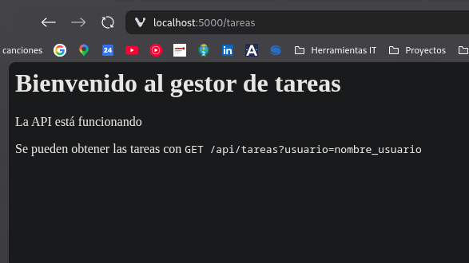

### Servidor y cliente funcionando y a la espera

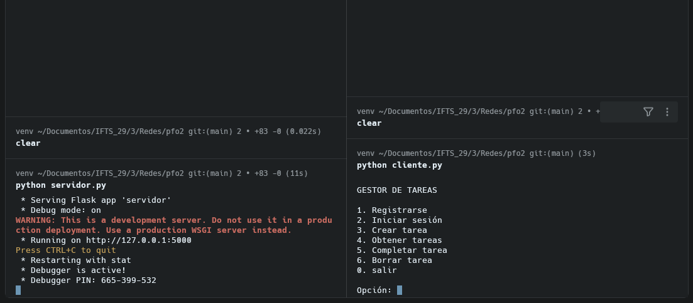

### Registro de usuario exitoso

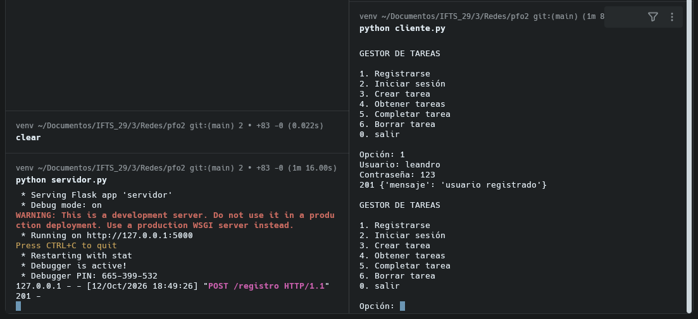

### Obtener tareas sin iniciar sesion

Al intentar obtener tareas, crear tarea, marcar como completada o intentar eliminar una tarea, el servidor respondera con error porque primero es necesario iniciar sesion.

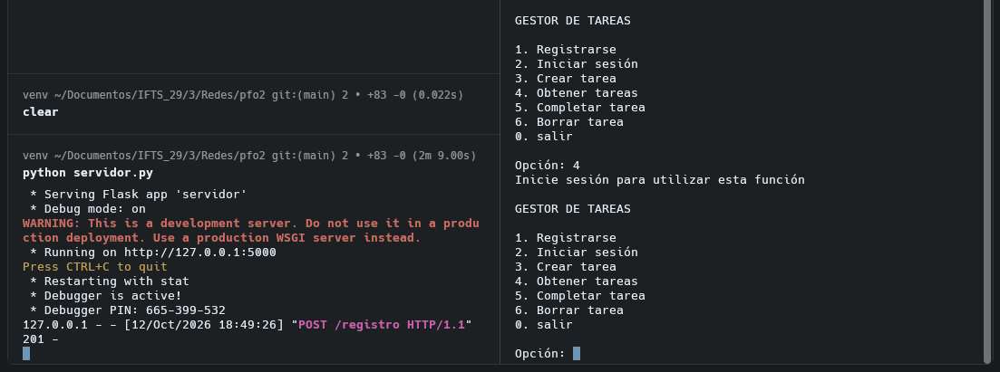

### Inicio de sesion exitoso

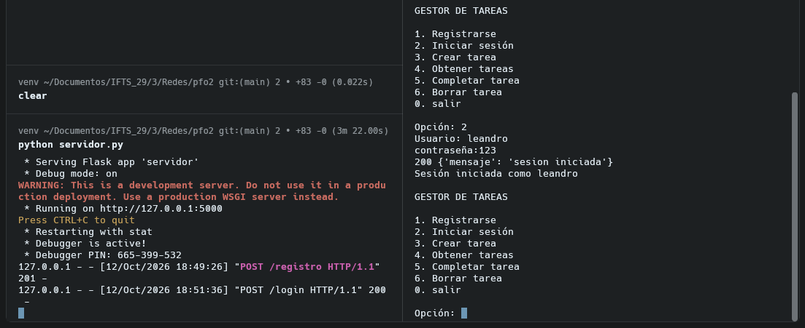

### Obtención de listado de tareas

En este caso el usuario todavía no registro ninguna tarea por lo que el servidor devuelve un array vacio

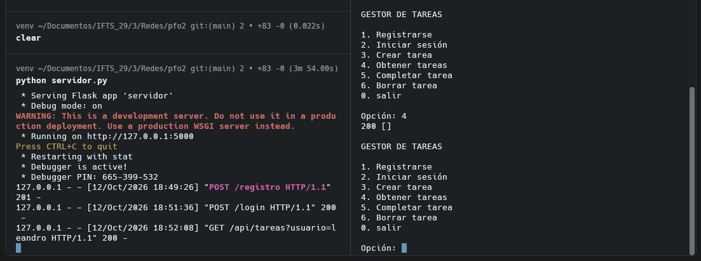

### Crear tarea

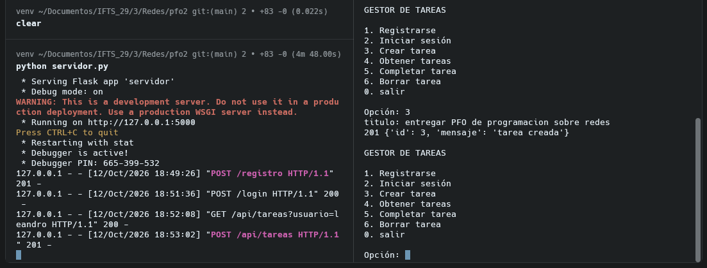

### Obtener tareas

Luego de que el usuario crea sus tareas ya las puede visualizar

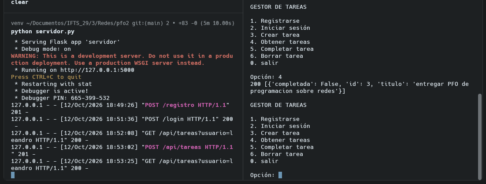

### Marcar tarea como completada

Con la opción 5 el usuario puede marcar una tarea como completada. Luego se observa el listado actualizado

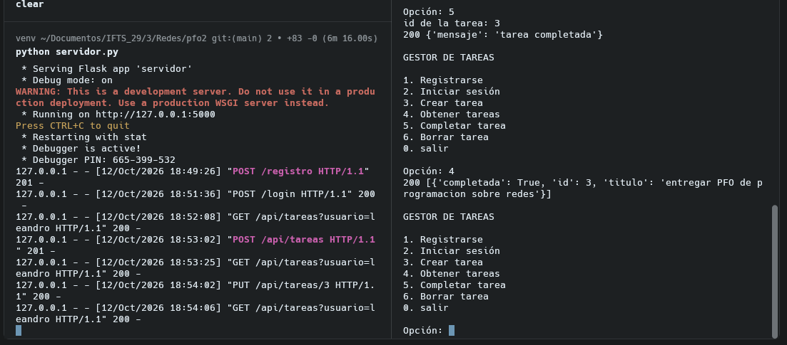

### Eliminar tarea

Con la opción 6 el usuario puede eliminar una tarea a través de su id. luego se observa el listado actualizado

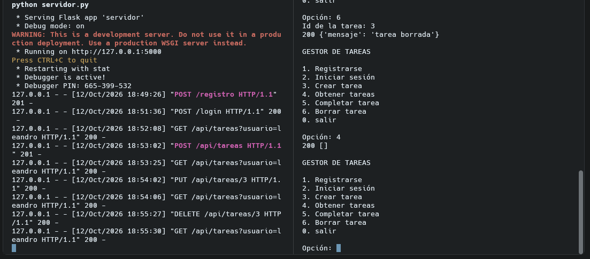

### Registro de nuevo usuario

Para probar el acceso por usuario a las tareas, se crea un nuevo usuario. Con este usuario se crea una nueva tarea

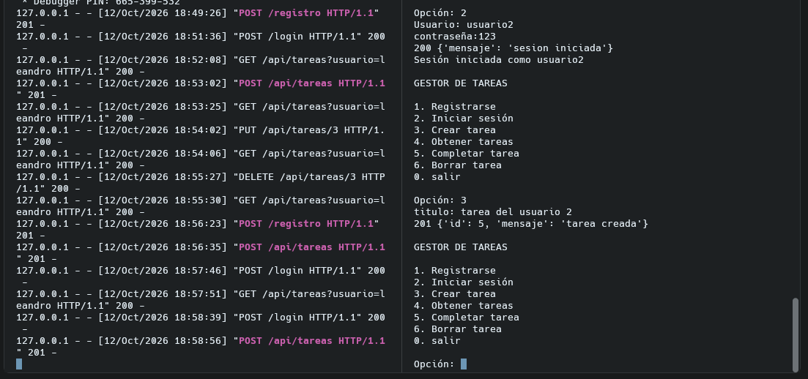

Al iniciar sesion con el primer usuario, este no puede visualizar las tareas del segundo usuario

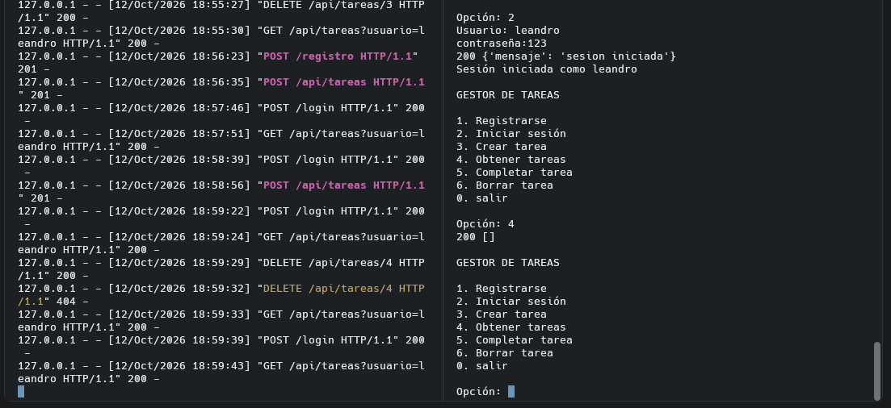
